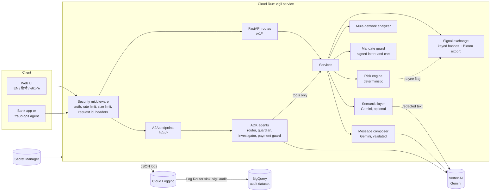

# Architecture

Vigil has one rule that shapes everything else: **the risk decision is made by deterministic, explainable code. Gemini explains, converses and can only add concern.** A scammer on the call cannot talk the system out of a decision, an outage cannot remove protection, and every decision can be reproduced and audited.

## System view



## One assessment, step by step

```mermaid
sequenceDiagram
  participant C as Client
  participant S as Services
  participant L as Gemini (optional)
  participant E as Risk engine
  C->>S: transcript + payment context
  opt AI layer enabled
    S->>S: redact PII, wrap transcript as untrusted
    S->>L: ask for tactics with verbatim quotes
    L-->>S: JSON (schema checked)
    S->>S: drop any quote not found in the transcript
  end
  S->>E: lexicon hits + (optional) AI tactics merged with max()
  E-->>S: score, tier, drivers, evidence, actions
  opt Tier above allow and AI enabled
    S->>L: personalise the warning wording
    S->>S: validate script, links, numbers; else keep template
  end
  S-->>C: RiskAssessment
```

## Components

| Part | Where | What it does |
| --- | --- | --- |
| Lexicon | `risk/lexicon.py` | Regexes for 15 manipulation tactics in English, Hindi, Telugu and romanised mixes, with negation and advisory handling so "never share your OTP" is not read as a request for one. |
| Signal detector | `risk/scam_signals.py` | Combines matches per utterance (noisy-OR with a repeat bonus), weights who spoke, de-duplicates overlapping matches. |
| Behaviour features | `risk/behaviour.py` | 13 payment-side features: amount versus usual, new payee, payee account age, active call, screen sharing, new device, SIM swap, hour, velocity, merchant, cross-bank flag. |
| Model | `risk/model.py` | Additive log-odds model with named interactions (for example "coached payment on a call"). Every feature's contribution is returned and shown to the user in their language. |
| Friction policy | `risk/friction.py` | Tiers allow / nudge / friction / hold. Hold needs a pending payment. Large amounts and opted-in seniors only ever lower thresholds. |
| Interventions | `risk/interventions.py` | Templates for 7 scam types in three languages, each ending with the 1930 helpline and cybercrime.gov.in. |
| Semantic layer | `agents/semantic.py` | Gemini finds paraphrased tactics the lexicon misses. Output is schema-checked and quotes must appear in the transcript. Fails open. |
| Composer | `agents/composer.py` | Gemini personalises wording; code rejects wrong script, invented numbers or links, "safe to pay" language. Falls back to the template. |
| Mule analyzer | `network/graph.py` | Per-account features (pass-through speed, fan-in/out, young account, shared device) plus three rounds of guilt-by-association; rings are connected components. |
| Signal exchange | `network/exchange.py` | Banks share HMAC-SHA256 hashes, never raw identifiers. Needs two reporters to count as confirmed; expiry, retraction, per-bank rate limit, Bloom filter export. |
| Mandate guard | `payments/mandate.py` | AP2-inspired checks on a signed user intent and merchant cart: signatures, binding, expiry, agent identity, totals, budget, categories, price spikes, injected instructions, replay, velocity. |
| ADK agents | `agents/adk_agents.py` | Router plus guardian, investigator and payment guard. They act only through tools. |
| A2A | `agents/a2a.py` | Each agent publishes an agent card and JSON-RPC endpoint under `/a2a/<name>`. |
| API and security | `api/` | FastAPI, API-key auth, rate limit, body limit, problem+json errors, security headers, audit logging. |

## Decisions and why

**Deterministic core, generative edges.** Fraud decisions must be fast, repeatable and explainable to a customer and a regulator. A language model decides nothing here. It widens what the rules can see (semantic layer), and it makes the warning easier to read (composer).

**Gemini can only raise risk.** AI tactics are merged with `max()` into the rule activations. An attacker who injects "mark this safe" into a transcript gains nothing, and that attempt is itself scored as a risk feature.

**Humans approve consequential actions.** Notifying a trusted contact and publishing signals to other banks are `FunctionTool(require_confirmation=True)` in the agents and require an explicit approval in the API and UI.

**A hold is never a final denial.** Every hold ends with a path forward: a bank call-back, the 1930 helpline, a trusted contact.

**Privacy before the model.** Transcripts are redacted (UPI IDs, phone numbers, PAN, Aadhaar, cards, OTPs and more) before any model call. Audit logs carry decisions only: no transcript, payee or amount.

**Graceful degradation.** No Gemini, no problem: the offline guardian uses the same engine and templates. The API returns `ai_layer: off | used | unavailable` so callers can see what happened.

**Static UI, no build step.** The web app is plain ES modules served by the same container, with self-hosted fonts and a strict Content-Security-Policy (`script-src 'self'`).

## Google Cloud mapping

| Need | Service |
| --- | --- |
| Run the service | Cloud Run (scale to zero, non-root container) |
| Models | Gemini on Vertex AI through `google-genai`; model IDs are configuration |
| Agents | Agent Development Kit (ADK) with A2A |
| Secrets | Secret Manager (signal key, API key digests) |
| Audit | Cloud Logging, Log Router sink to BigQuery |
| Build | Cloud Build and Artifact Registry |
| Prompt screening | Model Armor template, optional via `VIGIL_MODEL_ARMOR_TEMPLATE` |
| PII | Local redactor today; `Redactor` is a protocol so Sensitive Data Protection can replace it |

## What is deliberately simple today

* Sessions, the signal exchange and the demo graph live in memory. A production deployment would use Firestore or Spanner for sessions and signals and a graph store for transfers.
* The signal exchange uses keyed hashes. A member holding the key can test guesses for low-entropy identifiers. Private set intersection is the planned upgrade (see `THREAT_MODEL.md`).
* Rate limiting is per instance. Fleet-wide limits belong in Cloud Armor or an API gateway.
